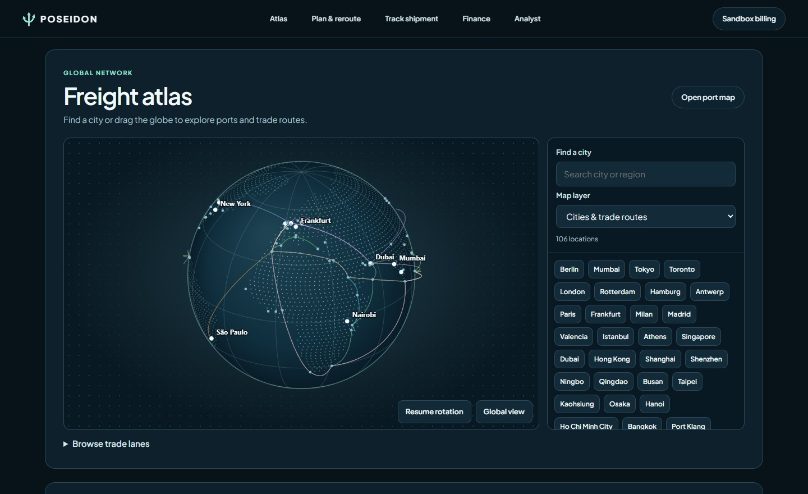

# Poseidon

Poseidon is a freight operations workspace for responding to missed connections. Track a shipment from its last reported hub, compare onward routes by cost, transit time, and estimated emissions, then review port conditions and supplier cash exposure.



## Run locally

You’ll need **Node.js 22 or later**.

```sh
git clone https://github.com/arham0408/Poseidon.git
cd Poseidon
npm start
```

Open [localhost:3000](http://localhost:3000/). The atlas, shipment history, route comparison, and finance tools work without API credentials.

## Try the missed-connection walkthrough

1. Open **Atlas**, select **Singapore**, then choose **TF-1042** under **Last reported here**. Its shipment history shows a missed onward connection on the Shanghai–Rotterdam route.
2. Select **Compare onward routes** to start from Singapore. Set **Avoid a waypoint** to **Port Said**, rank by **Lowest cost**, and select a result to highlight the route on the globe.
3. Select **Check news & weather** in the planner. With Groq configured, choose **Get a shipment brief** to ask the analyst to summarize disruption signals and route options.
4. Open **Sandbox billing** and select **Sync invoices**. With [invoice preview enabled](#configure-billing-and-the-analyst), this loads five generated records, including draft **TF-1042**. Return to the shipment and select **Check PayPal invoice** to look up that draft.
5. Open **Finance → Supplier cash forecast**. Select **Berlin → Mumbai** and reduce **Collection delay** from six days to four. The projected cash gap falls from **$22,000** to **$0** in this scenario.

## Configure billing and the analyst

Copy [`.env.example`](.env.example) to `.env` in the repository root. Use `cp .env.example .env` on macOS or Linux, or `Copy-Item .env.example .env` in PowerShell. Restart Poseidon after editing the file.

| Variable | What it enables |
| --- | --- |
| `PAYPAL_CLIENT_ID`, `PAYPAL_CLIENT_SECRET` | Authenticate with a [PayPal Sandbox REST app](https://developer.paypal.com/dashboard/applications/sandbox). Poseidon can list invoices, look up the shipment’s invoice number, and create or reuse an unsent freight draft. |
| `PAYPAL_INVOICE_PREVIEW` | Set to `1` to load labeled, generated invoice records for a walkthrough without calling PayPal. Set to `0` to use PayPal Sandbox. |
| `GROQ_API_KEY` | Connect the freight analyst to [GroqCloud](https://console.groq.com/keys). It uses `openai/gpt-oss-20b` with read-only tools for routes, branch finances, and port conditions. Invoice access is opt-in. |
| `PORT` | Local server port. Defaults to `3000`. |

Keep credentials in the server’s `.env` file. The Node.js server binds to the loopback interface for local use. Keep deployments that use API credentials private unless you add access controls and rate limits.

## How it works

- [**Frontend**](index.html) uses HTML, CSS, and vanilla JavaScript. A Canvas globe shows freight lanes, and OpenStreetMap embeds show the selected port or shipment location.
- [**Backend**](worker.mjs) handles PayPal OAuth and [Invoicing v2](https://developer.paypal.com/api/invoicing/v2), plus [Groq tool calling](https://console.groq.com/docs/tool-use/local-tool-calling). The [build script](build.mjs) bundles the page, data, and API handlers for the [local server](server.mjs).
- [**Port signals**](signals.mjs) combine Google News RSS headlines and an Open-Meteo weather outlook. The in-app **Data sources** panel documents the generated shipment histories and branch figures, and the assumptions behind route and cash estimates. Vessel tracking is available through an external MarineTraffic link.

## Verify the project

```sh
npm test
```

The test suite builds the app and checks shipment history, invoice preview, PayPal draft creation and lookup, and Groq tool calls. PayPal and Groq tests use controlled responses and run without credentials.
